<div align="center">
  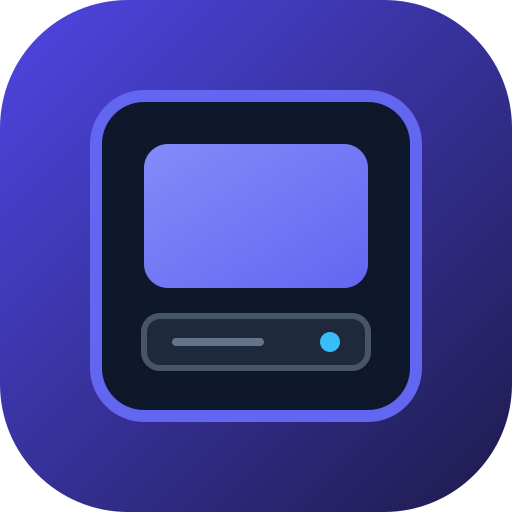
  <h1>OmniDesk</h1>
  <p><strong>The 100% Offline-First Desktop & Web Multi-Tool Workstation</strong></p>
  <p>
    98 integrated utilities for files, code, math, science, finance, planning, and everyday tasks — running locally in memory or natively via Tauri v2 with zero server telemetry.
  </p>

  <p>
    <a href="https://leonidcharikov.github.io/omnidesk.html">
      
    </a>
    
    
    
    
    
    
    
  </p>

  <p>
    <strong>🌐 Project Presentation:</strong> <a href="https://leonidcharikov.github.io/omnidesk.html">https://leonidcharikov.github.io/omnidesk.html</a>
  </p>

  <p>
    <a href="https://leonidcharikov.github.io/omnidesk.html">Presentation Website</a> •
    <a href="#-visual-showcase">Visual Showcase</a> •
    <a href="#-key-highlights">Key Highlights</a> •
    <a href="#-complete-tool-catalog-98-tools">Tool Catalog (98)</a> •
    <a href="#-themes-widgets--localization">Themes & Widgets</a> •
    <a href="#-quick-start">Quick Start</a> •
    <a href="#-project-structure">Project Structure</a>
  </p>
</div>

<br />

<div align="center">
  <a href="docs/screenshots/dashboard.png">
    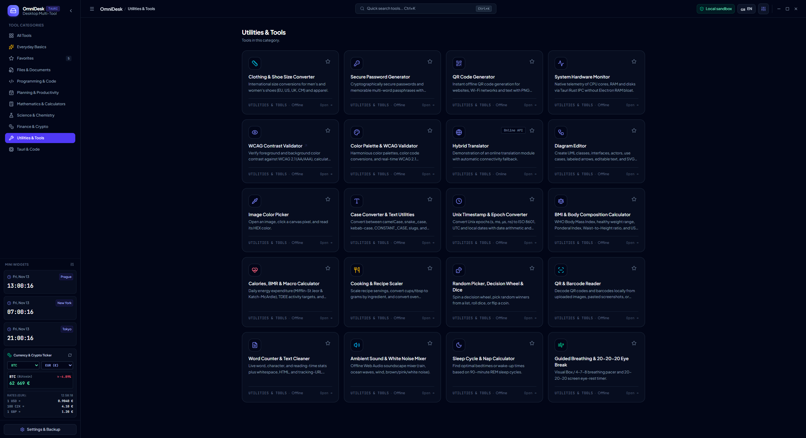
  </a>
  <br />
  <sub><strong>Main Workspace:</strong> Categorized tool grid with the <em>Everyday Basics</em> quick filter, favorites, live sidebar world clocks &amp; crypto ticker, and local Tauri sandbox status.</sub>
</div>

---

## ✨ Key Highlights

| Capability | Details |
| :--- | :--- |
| 🔒 **Privacy & Offline-First** | Every file edit, hash, PDF transformation, QR scan, image compression, and audio synthesis runs 100% locally in your browser or native Tauri runtime — zero tracking or cloud uploads. |
| ⚡ **Dual Runtime (Tauri v2 + Web/PWA)** | Run as a lightweight native desktop app powered by Rust/Tauri (with hardware telemetry & native filesystem dialogs) or install directly from your browser as a Progressive Web App. |
| 🧭 **Command Palette & Everyday Basics** | Press `Ctrl+K` (`⌘K`) anywhere to jump to any of the **98 tools**, pin favorites, or switch to **Everyday Basics** for instant access to 37 high-frequency daily utilities. |
| 💱 **Universal Multi-Currency Engine** | Configure a global default currency across 13+ world currencies (`CZK`, `EUR`, `USD`, `GBP`, `CHF`, `PLN`, `JPY`, etc.) — automatically synced across finance, loan, fuel, and shopping tools. |
| 🎨 **6 Color Themes & 7 Sidebar Widgets** | Switch seamlessly between 5 curated dark palettes and Clean Light mode, while toggling live world clocks, Pomodoro timer, crypto ticker, scratchpad, tasks, and system gauges. |
| 🌍 **5 Built-In Languages (i18n)** | Instant localization across **English** (`en`, default), **Čeština** (`cs`), **Deutsch** (`de`), **Español** (`es`), and **Русский** (`ru`), compatible with i18n Ally. |

---

## 📸 Visual Showcase

<table>
  <tr>
    <td width="50%" align="center">
      <a href="docs/screenshots/pdf-editor.png">
        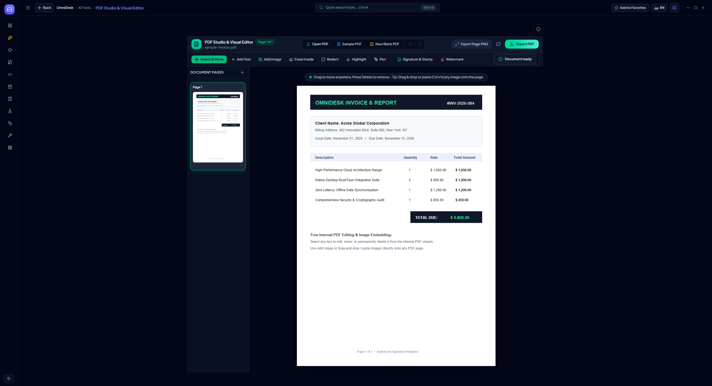
      </a>
      <br />
      <strong>📄 PDF Studio &amp; Visual Editor</strong><br />
      <sub>Direct text editing, image embedding, whiteout, redaction, signatures, watermarks &amp; page management.</sub>
    </td>
    <td width="50%" align="center">
      <a href="docs/screenshots/audio-editor.png">
        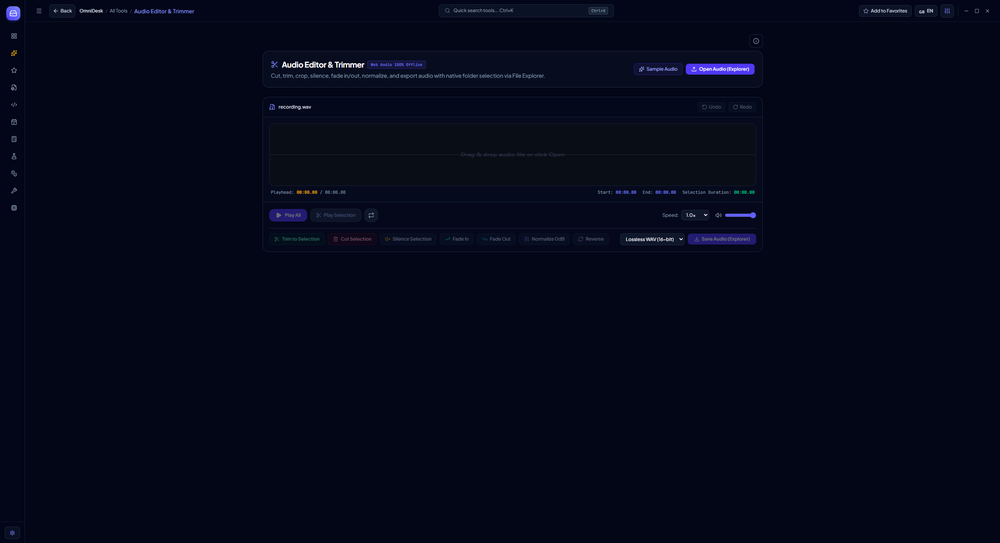
      </a>
      <br />
      <strong>🎧 Audio Editor &amp; Trimmer</strong><br />
      <sub>Interactive Web Audio waveform trimming, cutting, silence insertion, fade in/out, 0dB normalize &amp; WAV export.</sub>
    </td>
  </tr>
  <tr>
    <td width="50%" align="center">
      <a href="docs/screenshots/calendar.png">
        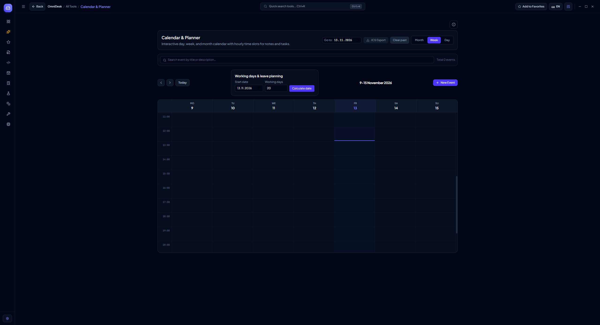
      </a>
      <br />
      <strong>📅 Calendar &amp; Leave Planner</strong><br />
      <sub>Month, Week &amp; Day views with hourly slots, instant search, working-days calculator &amp; .ICS export.</sub>
    </td>
    <td width="50%" align="center">
      <a href="docs/screenshots/crypto-rates.png">
        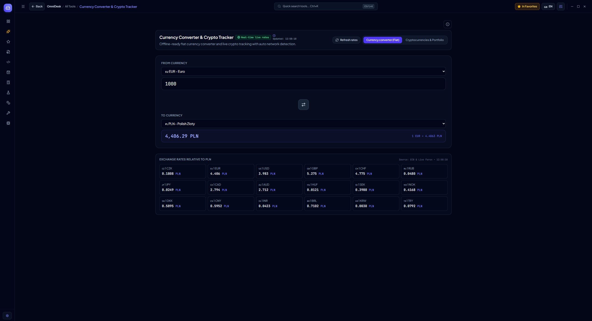
      </a>
      <br />
      <strong>💱 Currency Converter &amp; Crypto Tracker</strong><br />
      <sub>Offline-ready forex cross-rates across 19+ fiat currencies plus live cryptocurrency &amp; portfolio tracking.</sub>
    </td>
  </tr>
  <tr>
    <td width="50%" align="center">
      <a href="docs/screenshots/function-grapher.png">
        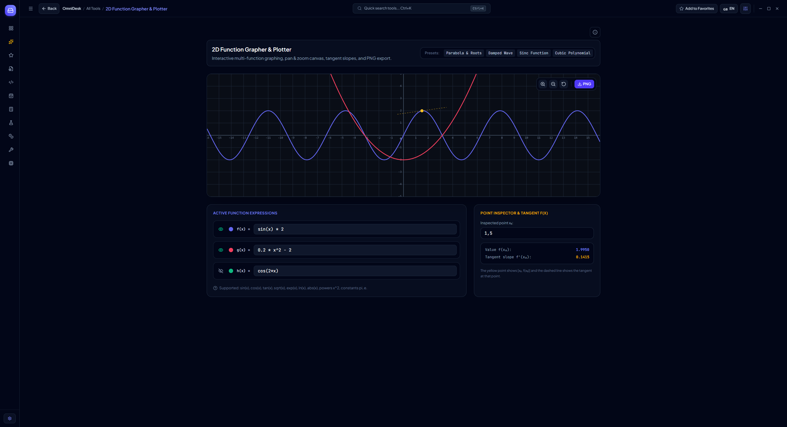
      </a>
      <br />
      <strong>📈 2D Function Grapher &amp; Plotter</strong><br />
      <sub>Multi-function expressions, drag pan &amp; zoom, point inspector with tangent slope &amp; PNG export.</sub>
    </td>
    <td width="50%" align="center">
      <a href="docs/screenshots/function-chemistry.png">
        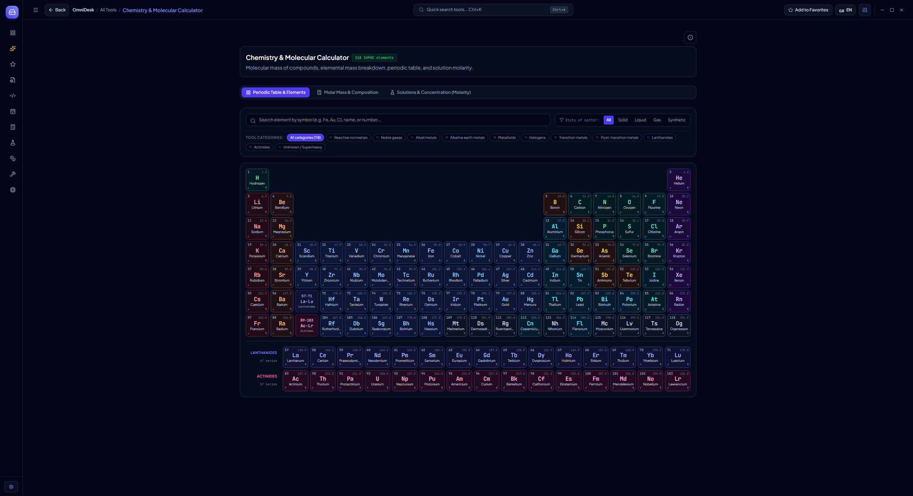
      </a>
      <br />
      <strong>🧪 Chemistry &amp; 118-Element Periodic Table</strong><br />
      <sub>Full IUPAC periodic table with state &amp; orbital filters, molar mass parser &amp; solution molarity solver.</sub>
    </td>
  </tr>
  <tr>
    <td width="50%" align="center">
      <a href="docs/screenshots/hash-suite.png">
        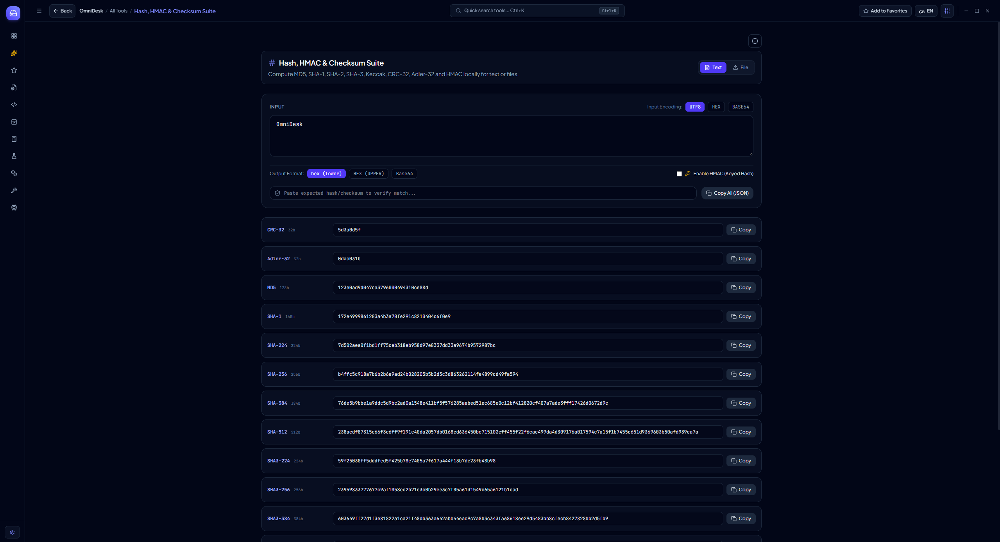
      </a>
      <br />
      <strong>🔐 Hash, HMAC &amp; Checksum Suite</strong><br />
      <sub>Simultaneous MD5, SHA-1, SHA-2, SHA-3, Keccak, CRC-32, Adler-32 &amp; keyed HMAC verification for text and files.</sub>
    </td>
    <td width="50%" align="center">
      <a href="docs/screenshots/random-picker.png">
        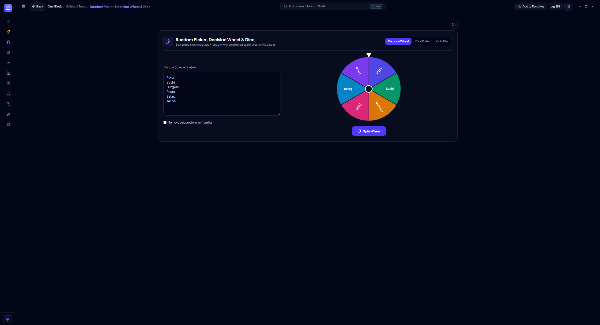
      </a>
      <br />
      <strong>🎲 Random Picker, Decision Wheel &amp; Dice</strong><br />
      <sub>Animated SVG decision wheel with winner removal, multi-dice roller (d4–d100) &amp; coin flip tracker.</sub>
    </td>
  </tr>
  <tr>
    <td colspan="2" align="center">
      <a href="docs/screenshots/config.png">
        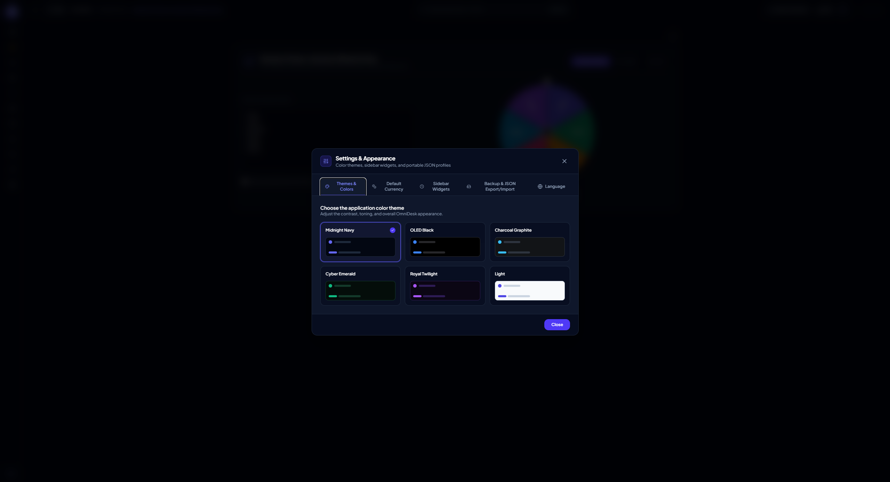
      </a>
      <br />
      <strong>⚙️ Settings, Themes, Currencies, Widgets &amp; Backup</strong><br />
      <sub>Switch between 6 visual themes, set default currency, toggle sidebar mini-widgets, change language, or export/restore your full JSON profile.</sub>
    </td>
  </tr>
</table>

---

## 🛠️ Complete Tool Catalog (98 Tools)

OmniDesk organizes **98 specialized tools** into **7 primary categories**, plus the **Everyday Basics** (`37` tools) quick filter for daily workflows.

<details open>
<summary><strong>📁 1. Files, Media &amp; Documents (14 Tools)</strong></summary>

1. **Text & Markdown Editor (`.txt` / `.md`)** — Selective font sizing, headings, alignment, regex search & replace, and local file saving.
2. **PDF Studio & Visual Editor** — Direct PDF text editing, image embedding, whiteout, redaction, highlighters, freehand pen, signatures, watermarks & page tools.
3. **PDF Toolkit** — Merge multiple PDFs or rotate pages locally.
4. **DOCX to PDF Converter** — Convert Word `.docx` files to PDF completely in memory.
5. **Multi-Format Converter** — Convert documents (`DOCX`/`MD`/`TXT` → `PDF`), structured data (`CSV` ↔ `JSON`), and images (`WebP`/`PNG`/`JPEG`).
6. **OCR Scanner** — Extract editable text from images locally using Tesseract.js.
7. **Image Editor** — Crop, resize, rotate, apply brightness/contrast filters, watermarks & export.
8. **Photo Compressor & EXIF Stripper** — Batch compress photos by quality or target KB while stripping GPS/camera EXIF metadata.
9. **Screenshot Annotator** — Add text callouts and annotations to screenshots with PNG export.
10. **Quick Sketchpad & Signature Pad** — HTML5 canvas drawing, brush controls, baseline guide & transparent PNG export.
11. **Audio Editor & Trimmer** — Interactive waveform trimming, cutting, silence insertion, fade in/out, normalization, speed & reverse.
12. **Offline Voice Recorder & Audio Memos** — Record microphone audio with live visualizer and WebM export.
13. **Screen & Webcam Recorder** — Local screen or webcam capture with optional microphone audio and WebM download.
14. **Markdown Preview & Export** — Live Markdown rendering with one-click HTML export.

</details>

<details>
<summary><strong>&lt;/&gt; 2. Programming &amp; Developer Suite (25 Tools)</strong></summary>

1. **Hash, HMAC & Checksum Suite** — Real-time MD5, SHA-1, SHA-2, SHA-3, Keccak, CRC-32, Adler-32 & keyed HMAC for text or files.
2. **AES Cipher & PBKDF2 Studio** — Encrypt/decrypt with AES-GCM, AES-CBC & AES-CTR (`128/192/256-bit`) and PBKDF2 key derivation.
3. **File Hashing & Encryption** — SHA-256 digests and password-protected AES-GCM file encryption.
4. **File Inspector & Hash** — Binary hex dump, MIME inspection, and cryptographic checksums.
5. **Base32 / Base58 / Base64 & Web Encoder** — Encode/decode Base32, Base58, Base64URL, HTML entities, URL params & Unicode escapes.
6. **UUID (v1–v7), ULID & NanoID Generator** — Bulk ID generation plus timestamp/metadata decoding.
7. **JWT Decoder** — Inspect JSON Web Token headers and payloads locally.
8. **JSON Formatter & Validator** — Beautify, minify & validate JSON payloads.
9. **JSONPath Query Explorer** — Filter and extract JSON structures interactively using JSONPath expressions.
10. **Structured Data & TypeScript Generator** — Convert between JSON, YAML, TOML & CSV or generate TypeScript interfaces & JSON Schema.
11. **XML Formatter & Validator** — Browser-native XML parsing, error reporting & pretty printing.
12. **YAML Formatter & Validator** — Clean and normalize YAML configuration blocks locally.
13. **CSS / HTML / JavaScript Minifier** — Strip comments and whitespace locally.
14. **Markdown Table Generator** — Convert delimited rows into clean Markdown tables.
15. **RegEx Tester & Base64 / URL** — Evaluate regular expressions with capture groups alongside Base64/URL utilities.
16. **Regex Builder** — Escape literal strings and combine flags safely.
17. **Text & File Diff Checker** — Line-by-line side-by-side and inline diff comparison.
18. **Number Base & Bitwise Converter** — Arbitrary-precision `BigInt` conversion (bases `2–36`), two's complement & bitwise operations.
19. **Binary & Hex Converter** — UTF-8 to byte-level binary and hexadecimal encoding.
20. **Cron Expression Builder & Simulator** — Visual 5-field cron editor with upcoming execution timestamps.
21. **IPv4 / IPv6 Subnet & CIDR Calculator** — Network/broadcast addresses, netmasks, host ranges & subnet splitting.
22. **Chmod Calculator & HTTP / MIME / ASCII** — Interactive Unix permissions calculator and searchable protocol/MIME/ASCII tables.
23. **SQL Playground** — Run local `SELECT` queries directly against JSON datasets without a server.
24. **API Tester** — Dispatch HTTP `GET/POST/PUT/DELETE` requests and inspect JSON/text responses.
25. **Git Tools** — Filter and clean pasted Git logs or diffs locally.

</details>

<details>
<summary><strong>📅 3. Planning, Productivity &amp; Learning (10 Tools)</strong></summary>

1. **Calendar & Planner** — Month, Week & Day views, hourly time slots, event search, working-days leave calculator & `.ICS` export.
2. **Pomodoro, Stopwatch & Timer** — Focus/break intervals with audio alerts, countdown timer & lap-split stopwatch.
3. **World Timezones & Meeting Planner** — Multi-city world clock with interactive meeting-hour scrubber.
4. **Smart Shopping List & Checklist** — Categorized shopping checklist with quick presets, estimated total & active currency formatting.
5. **To-do / Kanban Board** — Organize tasks across Planned, In Progress & Done columns.
6. **Notes Workspace** — Searchable multi-note workspace with automatic local persistence.
7. **Date Difference, Age & Countdown** — Exact age breakdown, days between dates, date offsets & persisted event countdowns.
8. **Habit Tracker & Streak Grid** — 7-day rolling habit check-in grid with automatic streak counters and quick presets.
9. **Packing & Travel Checklists** — 5 reusable trip templates (Weekend, Beach, Carry-On, Camping, Daily Gym) + custom items.
10. **Simple Flashcards (Study Deck)** — Create custom Q&A study decks, flip cards & track mastery queues offline.

</details>

<details>
<summary><strong>📐 4. Mathematics &amp; Statistics (8 Tools)</strong></summary>

1. **Standard & Scientific Calculator** — Trigonometry, logarithms, powers, memory registers (`M+`/`MR`) & calculation history.
2. **Dynamic Matrix Calculator (`1×1` to `6×6`)** — Multiplication ($A \times B$, $B \times A$), determinants, inverses, transpose & trace.
3. **2D Function Grapher & Plotter** — Plot $f(x)$, $g(x)$, $h(x)$ with pan/zoom, point tangent slope inspection & PNG export.
4. **LaTeX Formula Visualizer** — Live math preview, symbol palette, equation library & SVG/MathML export.
5. **Statistics & Data Analysis** — Mean, median, mode, variance, standard deviation, quartiles (`Q1`/`Q3`/`IQR`) & histograms.
6. **Combinatorics & Number Theory** — Permutations, combinations ($nCr$), GCD/LCM & prime factorization.
7. **Simple Percentage & Ratio Calculator** — Everyday percentage modes (`X% of Y`, `% change`, `+/- %`) and proportional aspect-ratio solver.
8. **Grade & Weighted Average Calculator** — Weighted course averages, 4.0 GPA scale & Final Exam Target Score solver.

</details>

<details>
<summary><strong>🔬 5. Science, Chemistry &amp; Engineering (8 Tools)</strong></summary>

1. **Chemistry & Periodic Table (118 Elements)** — Official 18-column IUPAC table, orbital block filters, molar mass parser & solution molarity ($c = n/V$).
2. **Chemical Equation Balancer & Stoichiometry** — Automatic reaction balancing, limiting reactant & theoretical yield.
3. **Physics & Mechanics Toolkit** — Projectile motion, ideal gas law ($PV=nRT$), energy, wave equations & decibels.
4. **Electronics & Circuit Calculator** — Ohm's law, series/parallel resistors, voltage dividers, LED current-limiting resistor & RC filters.
5. **DNA / RNA & Protein Sequence Analyzer** — Complement, reverse complement, mRNA transcription, 3-frame translation & GC%.
6. **Solar, Moon & Geodesic Ephemeris** — Sunrise/sunset, golden hour, lunar phase, Julian date & Haversine distance.
7. **Scientific Unit Converter** — Precision conversions across length, mass, temperature, pressure, energy & data storage.
8. **Geographic & GPS Converter** — Decimal degrees ↔ DMS (Degrees, Minutes, Seconds) conversion.

</details>

<details>
<summary><strong>💰 6. Finance, Investing &amp; Calculators (13 Tools)</strong></summary>

1. **Currency Converter & Crypto Tracker** — 19+ fiat currencies and 14 cryptocurrencies with live/offline rates & portfolio tracking.
2. **Mortgage & Loan Calculator** — Annuity payments, principal vs. interest breakdown & CSV amortization schedule.
3. **Discount, VAT & Tip Calculator** — Percentage discounts, BOGO offers, two-way VAT extraction & fair restaurant bill splitting.
4. **Fuel Cost, EV Charging & Trip Calculator** — Fuel trip cost & passenger split, EV kWh charging cost/time & `L/100km ↔ MPG ↔ km/L` converter.
5. **Expense Tracker & Budget** — Record categorized spending and monitor running totals.
6. **Investment Calculator** — Compound growth projections with initial principal and monthly contributions.
7. **Periodic Finance Calculator** — Compound interest evaluated across custom compounding intervals.
8. **NPV, IRR & CAGR Cashflow Analyzer** — Net Present Value, Internal Rate of Return, payback & CAGR metrics.
9. **Break-Even, Margin vs. Markup & Pricing** — Break-even units, margin/markup conversion & SaaS LTV/CAC modeling.
10. **Portfolio Rebalancer & DCA Planner** — Exact buy/sell rebalancing orders and Lump-Sum vs. DCA comparisons.
11. **FIRE & Retirement Simulator** — Financial independence, Coast-FIRE, real inflation-adjusted return & safe withdrawal rate.
12. **Freelance Rate & Salary Converter** — Sustainable hourly/day rate calculator factoring in taxes, overhead & PTO.
13. **Invoice Generator** — Generate printable HTML invoices from structured line items.

</details>

<details>
<summary><strong>⚙️ 7. Everyday Utilities &amp; Wellness (20 Tools)</strong></summary>

1. **Cooking & Recipe Scaler** — Scale recipe servings, convert cups/tbsp to grams by ingredient density & convert oven temperatures (`°C`, `Fan`, `°F`, `Gas Mark`).
2. **Random Picker, Decision Wheel & Dice** — Animated SVG decision wheel (with optional winner removal), multi-dice roller & coin flip.
3. **QR & Barcode Reader** — Decode QR codes and barcodes locally from uploaded images, pasted screenshots (`Ctrl+V`) or webcam.
4. **Offline QR Code Generator** — Vector QR codes for URLs, Wi-Fi networks & plain text with PNG export.
5. **Word Counter & Text Cleaner** — Word, character, reading-time & top-word stats plus whitespace, HTML & tracking-URL (`utm_*`, `fbclid`) cleanup.
6. **Case Converter & Text Utilities** — Instant `camelCase`, `snake_case`, `kebab-case`, `CONSTANT_CASE`, URL slugs & line sorting.
7. **Ambient Sound & White Noise Mixer** — Offline Web Audio soundscape generator (rain, waves, wind, brown/pink/white noise) with presets & sleep timer.
8. **Sleep Cycle & Nap Calculator** — Optimal 90-minute sleep cycle bedtimes/wake-up times and power-nap guide.
9. **Guided Breathing & 20-20-20 Eye Break** — Visual Box, 4-7-8 & Coherent breathing pacer with chime + 20-20-20 screen eye-rest timer.
10. **BMI & Body Composition Calculator** — WHO BMI, healthy weight window, Ponderal Index & US Navy body fat estimate.
11. **Calories, BMR & Macro Calculator** — Mifflin-St Jeor & Katch-McArdle BMR, TDEE activity multipliers & macro split.
12. **Clothing & Shoe Size Converter** — Men's & women's international shoe (`EU/US/UK/CM/in`) and apparel (`XS–3XL`) charts.
13. **Cryptographic Password Generator** — Custom-charset passwords and memorable Diceware passphrases with bit-entropy scoring.
14. **Unix Timestamp & Epoch Converter** — Live epoch clock, `s/ms/µs/ns` conversion, date arithmetic & batch parsing.
15. **WCAG Contrast Validator** — Level AA/AAA contrast verification, color-blindness simulation & automated contrast tuning.
16. **Color Palette & Generator** — Harmonic color schemes with HEX/RGB/HSL conversions.
17. **Image Color Picker** — Click any image pixel to extract its exact HEX color value.
18. **Diagram Editor** — Create UML classes, actors, use-cases, and labeled arrows with SVG export.
19. **System Hardware Monitor** — Native CPU core, RAM & disk telemetry via Tauri Rust APIs.
20. **Hybrid Online Translator** — Quick translation tool with automatic connectivity detection.

</details>

---

## 🎨 Themes, Widgets & Localization

<details>
<summary><strong>Visual Palettes, Sidebar Mini-Widgets, Languages &amp; Profile Backup</strong></summary>

### 6 Color Palettes
- **Midnight Navy** — Deep navy workspace with indigo accents *(default)*
- **OLED Black** — True `#000000` pitch-black dark mode
- **Charcoal Graphite** — Matte neutral developer grey
- **Cyber Emerald** — Dark terminal forest green palette
- **Royal Twilight** — Deep amethyst & violet tones
- **Light** — Clean daylight theme with crisp white surfaces

### 7 Configurable Sidebar Mini-Widgets
1. **World Clock & Date** — Live local time for selected global cities
2. **Quick Focus / Pomodoro Timer** — 25-minute timer with circular progress ring
3. **Currency & Crypto Ticker** — Live cross-rates and crypto selector right in the sidebar
4. **Daily Tasks Checklist** — Quick interactive todo list
5. **Quick Calculator** — Inline math & expression evaluator
6. **Scratchpad Note** — Auto-saved sticky note for quick snippets
7. **System Gauge** — CPU & RAM utilization overview

### 5 Languages & JSON Profile Backup
- **Supported Locales**: English (`en`), Čeština (`cs`), Deutsch (`de`), Español (`es`), Русский (`ru`)
- **Backup & Portability**: Export or restore your entire configuration (`omnidesk-profile.json`), copy/paste JSON settings across devices, or factory-reset at any time.

</details>

---

## 🚀 Quick Start

### Option 1 — Pre-Built Desktop Releases
Download the latest installer for **Windows** (`.exe` / `.msi`), **macOS** (`.dmg`), or **Linux** (`.AppImage` / `.deb`) from the **Releases** page.

### Option 2 — One-Click Launcher
- **Windows:** Double-click `start.bat`
- **macOS / Linux:** Run `./start.sh`

### Option 3 — Web Development Server & PWA
```bash
npm install
npm run dev
```
Open **[http://localhost:3000](http://localhost:3000)** and optionally click **Install App** in the header to install OmniDesk as a standalone PWA.

### Option 4 — Tauri v2 Desktop Development
```bash
npm install
npm run tauri dev
```

<details>
<summary><strong>Windows MSVC + Windows SDK PowerShell Environment Setup</strong></summary>

```powershell
$msvc="C:\Program Files (x86)\Microsoft Visual Studio\18\BuildTools\VC\Tools\MSVC\14.44.35207"
$sdk="C:\Program Files (x86)\Windows Kits\10"
$sdkver="10.0.26100.0"

$env:Path="$msvc\bin\HostX64\x64;$env:Path"
$env:INCLUDE="$msvc\include;$sdk\Include\$sdkver\ucrt;$sdk\Include\$sdkver\shared;$sdk\Include\$sdkver\um"
$env:LIB="$msvc\lib\x64;$sdk\Lib\$sdkver\ucrt\x64;$sdk\Lib\$sdkver\um\x64"

npm run tauri dev
```

*(You can also run the pre-configured **Tauri Dev (MSVC)** task in VS Code via **Terminal → Run Task**.)*

</details>

---

## 📁 Project Structure

```text
├── docs/screenshots/          # High-resolution README showcase screenshots
├── public/                    # Static icons, logos, PWA manifest & assets
├── src-tauri/                 # Tauri v2 Rust backend, capabilities & desktop icons
├── src/
│   ├── components/
│   │   ├── layout/            # Header, Sidebar, SidebarWidgets, ToolGrid, CommandPalette
│   │   └── ui/                # ConfigModal, ErrorBoundary, PWAInstallButton
│   ├── i18n/                  # Translation context & multi-language tool catalog
│   ├── locales/               # Locale dictionaries (en, cs, de, es, ru)
│   ├── services/              # Local storage, currency service, themes & Tauri FS bridge
│   ├── tools/
│   │   ├── files/             # PDF Studio, Audio Editor, Photo Compressor, Screen/Webcam Recorder...
│   │   ├── programming/       # Hash Suite, AES Studio, CIDR, Cron, Encoding, UUID, JSONPath...
│   │   ├── planning/          # Calendar, Habits, Packing Checklists, Flashcards, Shopping List...
│   │   ├── math/              # Calculator, 2D Grapher, Matrix, LaTeX, Statistics, Grades, % & Ratio
│   │   ├── science/           # 118-Element Chemistry, Balancer, Electronics, Physics, DNA, Ephemeris
│   │   ├── finance/           # Currency/Crypto, Loans, Fuel/EV Trip, FIRE, Portfolio, NPV/IRR
│   │   ├── utilities/         # Random Picker, QR Reader, Recipe Scaler, Noise Mixer, Sleep, Breathing...
│   │   ├── expanded/          # Additional & More workspace utilities
│   │   └── registry.ts        # Central 98-tool registry & Everyday Basics metadata
│   ├── types/                 # Strict TypeScript tool & category interfaces
│   ├── App.tsx                # Root workspace layout & category routing
│   └── index.css              # Tailwind CSS v4 + 6 theme overrides
├── start.bat / start.sh       # One-click local launchers
├── package.json
└── vite.config.ts
```

---

## 📄 License

Released under the **MIT License**.
