<div align="center">
  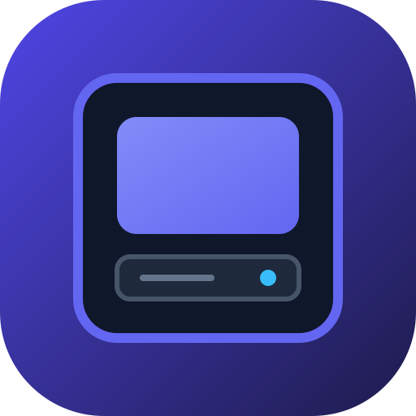
  <h1>OmniDesk</h1>
  <p><strong>The 100% Offline-First Desktop & Web Multi-Tool Workstation</strong></p>
  <p>
    99 integrated utilities for files, code, math, science, finance, planning, and everyday tasks — running locally in memory or natively via Tauri v2 with zero server telemetry.
  </p>

  <p>
    <a href="https://leonidcharikov.github.io/OmniDesk/">
      
    </a>
    <a href="https://leonidcharikov.github.io/omnidesk.html">
      
    </a>
    
    
    
    
    
    
    
  </p>

  <p>
    <strong>🚀 Live Web App (Run in Browser):</strong> <a href="https://leonidcharikov.github.io/OmniDesk/">https://leonidcharikov.github.io/OmniDesk/</a><br />
    <strong>🌐 Project Presentation:</strong> <a href="https://leonidcharikov.github.io/omnidesk.html">https://leonidcharikov.github.io/omnidesk.html</a><br />
    <strong>💻 Source &amp; Desktop Releases:</strong> <a href="https://github.com/LeonidCharikov/OmniDesk">https://github.com/LeonidCharikov/OmniDesk</a>
  </p>

  <p>
    <a href="https://leonidcharikov.github.io/OmniDesk/">Live Web App</a> •
    <a href="https://leonidcharikov.github.io/omnidesk.html">Presentation Website</a> •
    <a href="https://github.com/LeonidCharikov/OmniDesk">GitHub Repo</a> •
    <a href="#-visual-showcase">Visual Showcase</a> •
    <a href="#-key-highlights">Key Highlights</a> •
    <a href="#-complete-tool-catalog-99-tools">Tool Catalog (99)</a> •
    <a href="#-themes-widgets--localization">Themes & Widgets</a> •
    <a href="#-quick-start">Quick Start</a> •
    <a href="#-project-structure">Project Structure</a>
  </p>
</div>

<br />

<div align="center">
  <a href="docs/screenshots/dashboard.png">
    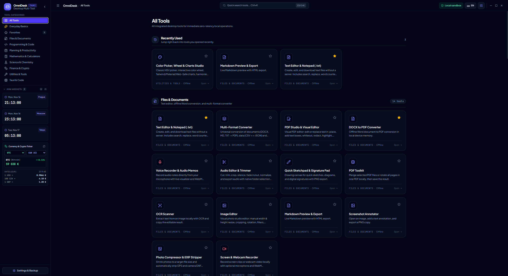
  </a>
  <br />
  <sub><strong>Main Workspace:</strong> Categorized tool grid with the <em>Everyday Basics</em> quick filter, favorites, live sidebar world clocks &amp; crypto ticker, and local Tauri sandbox status.</sub>
</div>

---

## ✨ Key Highlights

| Capability | Details |
| :--- | :--- |
| 🔒 **Privacy, Lock Screen & Full Workspace Backup** | Every file edit, hash, PDF edit, QR scan, image compression, and color conversion runs 100% locally — installable as an offline-first PWA. On the **Tauri Desktop** build, also includes optional **PBKDF2 PIN Lock Screen**, **Full Workspace Backup** (settings + Calendar, Kanban, Notes, Expenses, Habits, Shopping List, Flashcards), and **AES-256-GCM encrypted bundles** (stripped on Web so browser users stay focused on individual tools). |
| ⚡ **Dual Runtime (Tauri v2 + Web/PWA), Workers & Auto-Updater** | Native **Tauri v2** desktop app (with **signed GitHub Releases Auto-Updater**, `sysinfo` hardware telemetry, OS tray mode, file associations & quick Web/GitHub links) or streamlined offline browser PWA. Heavy dependencies (`pdf-lib`, `tesseract.js`, MCP client), **Web Workers** (batch photo compression & cryptographic hashing), and **IndexedDB** tool storage keep the UI responsive with minimal RAM usage. |
| 🖨️ **Built-In Document & Media Printing** | Print directly via native OS print dialogs without popup blockers from **PDF Studio**, **Image Editor**, **Text & Markdown Editor**, **Markdown Preview**, **Notes**, **Diagram Editor**, **Invoice Generator**, **Screenshot Annotator**, **Sketchpad**, and **QR Code Generator**. |
| 🧭 **Extended Command Palette & Customizable Shortcuts** | Press `Ctrl+K` (`⌘K`) to search across **99 tools**, saved **Notes**, **Calendar events**, **Settings tabs**, and **Themes**. Rebind built-in actions or assign custom keyboard shortcuts to any tool in **Settings → Shortcuts** (press `Shift+?` for cheat sheet). |
| 🔗 **Cross-Tool Piping & Smart Drag-and-Drop** | Pipe outputs directly between compatible tools with **Send to...** (`toolPipeService`), or drag & drop any file anywhere on the window to launch the **Smart Drop Router** with matching tools and 1-click **Load Sample** demos. |
| 💱 **Universal Multi-Currency Engine & Starter Presets** | Configure a global default currency across 13+ world currencies (`CZK`, `EUR`, `USD`, `GBP`, `CHF`, `PLN`, `JPY`, etc.) synced across finance tools, plus 1-click **Workspace Starter Presets** (*Developer*, *Student & Science*, *Finance & Daily*). |
| 🎨 **6 Themes & Adaptive Mini-Widgets *(Desktop)*** | Switch seamlessly between 5 curated dark palettes and Clean Light mode across both Desktop and Web, while the **Tauri Desktop** app adds 7 sidebar mini-widgets with automatic **compact tabbed mode** on smaller screens and subtle non-blocking **Toast notifications**. |
| 🤖 **MCP Bridge *(Desktop App Only)*** | Exclusive to the **Tauri Desktop** build (stripped from the Web/PWA version): connect AI assistants (Claude Desktop, Cursor, VS Code, Windsurf) via WebSocket or Tauri `stdio` IPC to Calendar, Tasks, Notes, System Telemetry, Tool Navigation, and Clipboard Sync with **Connected Tools**, **MCP Log**, and interactive setup tutorial. |
| 🌍 **5 Built-In Languages with Crisp SVG Flags** | Instant localization across **English** (`en`, default), **Čeština** (`cs`), **Deutsch** (`de`), **Español** (`es`), and **Русский** (`ru`) with cross-platform inline SVG flag icons (rendered identically on Windows, macOS, Linux, and web) and automated i18n checks. |

---

## 📸 Visual Showcase

<table>
  <tr>
    <td width="50%" align="center">
      <a href="docs/screenshots/pdf-editor.png">
        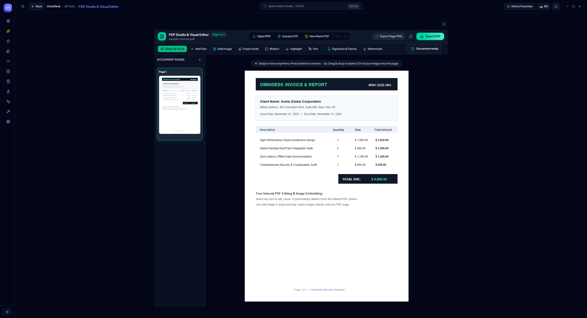
      </a>
      <br />
      <strong>📄 PDF Studio &amp; Visual Editor</strong><br />
      <sub>Direct text editing, image embedding, whiteout, redaction, signatures, watermarks &amp; page management.</sub>
    </td>
    <td width="50%" align="center">
      <a href="docs/screenshots/audio-editor.png">
        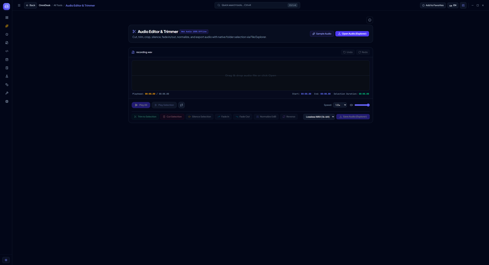
      </a>
      <br />
      <strong>🎧 Audio Editor &amp; Trimmer</strong><br />
      <sub>Interactive Web Audio waveform trimming, cutting, silence insertion, fade in/out, 0dB normalize &amp; WAV export.</sub>
    </td>
  </tr>
  <tr>
    <td width="50%" align="center">
      <a href="docs/screenshots/calendar.png">
        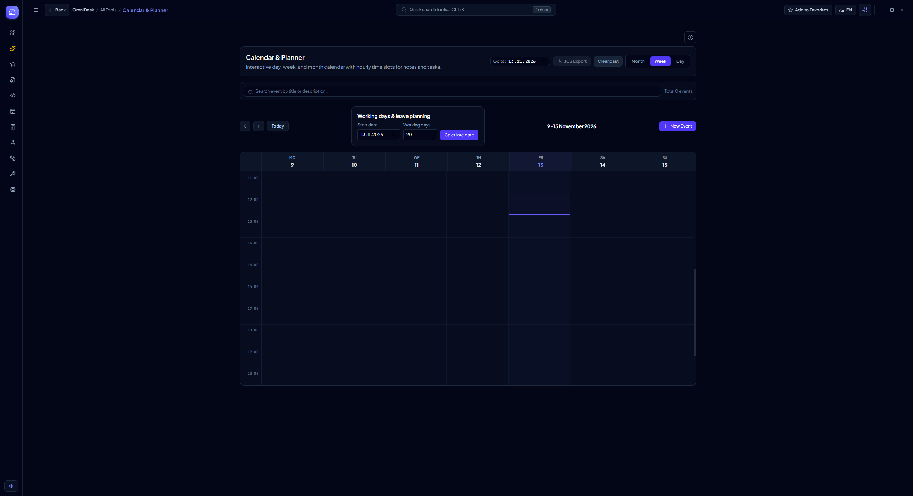
      </a>
      <br />
      <strong>📅 Calendar &amp; Leave Planner</strong><br />
      <sub>Month, Week &amp; Day views with hourly slots, instant search, working-days calculator &amp; .ICS export.</sub>
    </td>
    <td width="50%" align="center">
      <a href="docs/screenshots/crypto-rates.png">
        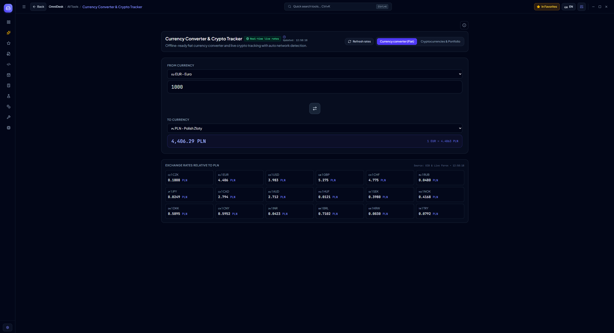
      </a>
      <br />
      <strong>💱 Currency Converter &amp; Crypto Tracker</strong><br />
      <sub>Offline-ready forex cross-rates across 19+ fiat currencies plus live cryptocurrency &amp; portfolio tracking.</sub>
    </td>
  </tr>
  <tr>
    <td width="50%" align="center">
      <a href="docs/screenshots/function-grapher.png">
        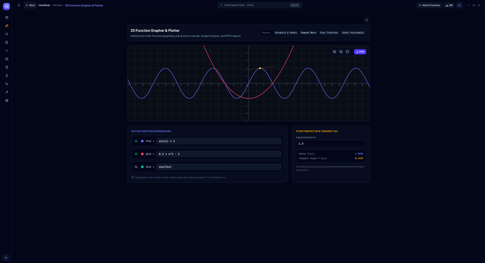
      </a>
      <br />
      <strong>📈 2D Function Grapher &amp; Plotter</strong><br />
      <sub>Multi-function expressions, drag pan &amp; zoom, point inspector with tangent slope &amp; PNG export.</sub>
    </td>
    <td width="50%" align="center">
      <a href="docs/screenshots/function-chemistry.png">
        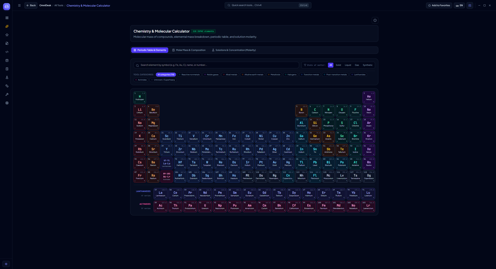
      </a>
      <br />
      <strong>🧪 Chemistry &amp; 118-Element Periodic Table</strong><br />
      <sub>Full IUPAC periodic table with state &amp; orbital filters, molar mass parser &amp; solution molarity solver.</sub>
    </td>
  </tr>
  <tr>
    <td width="50%" align="center">
      <a href="docs/screenshots/hash-suite.png">
        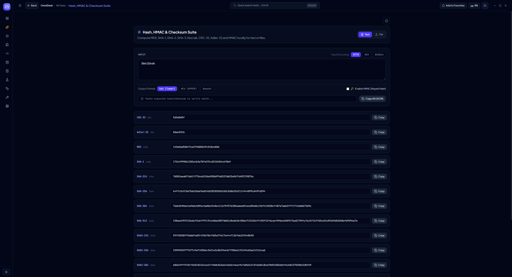
      </a>
      <br />
      <strong>🔐 Hash, HMAC &amp; Checksum Suite</strong><br />
      <sub>Simultaneous MD5, SHA-1, SHA-2, SHA-3, Keccak, CRC-32, Adler-32 &amp; keyed HMAC verification for text and files.</sub>
    </td>
    <td width="50%" align="center">
      <a href="docs/screenshots/color-picker.png">
        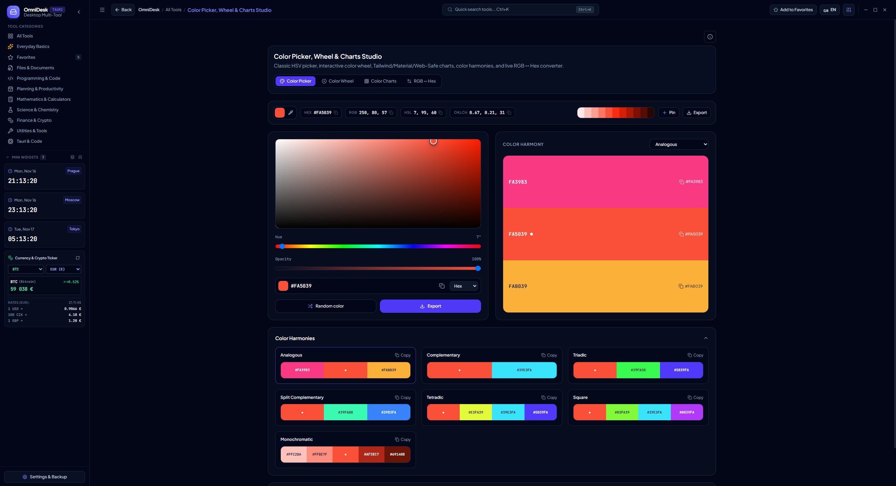
      </a>
      <br />
      <strong>🎨 Color Picker, Wheel &amp; Charts Studio</strong><br />
      <sub>Classic HSV picker, interactive color wheel, Tailwind/Material/Web-Safe charts, 7 harmony schemes &amp; live RGB ↔ Hex converter.</sub>
    </td>
  </tr>
  <tr>
    <td colspan="2" align="center">
      <a href="docs/screenshots/config.png">
        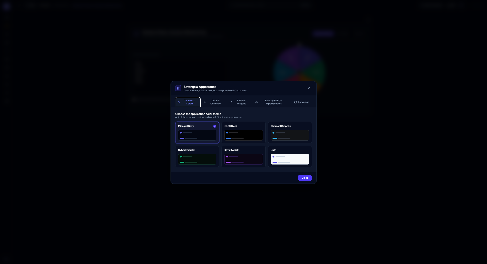
      </a>
      <br />
      <strong>⚙️ Settings, Themes, Currencies, Widgets &amp; Backup</strong><br />
      <sub>Switch between 6 visual themes, set default currency, toggle sidebar mini-widgets, change language, or export/restore your full JSON profile.</sub>
    </td>
  </tr>
</table>

---

## 🛠️ Complete Tool Catalog (99 Tools)

OmniDesk organizes **99 specialized tools** into **7 primary categories**, plus the **Everyday Basics** (`38` tools) quick filter for daily workflows.

<details open>
<summary><strong>📁 1. Files, Media &amp; Documents (14 Tools)</strong></summary>

1. **Text & Markdown Editor (`.txt` / `.md`)** — Selective font sizing, headings, alignment, regex search & replace, direct printing, and local file saving.
2. **PDF Studio & Visual Editor** — Direct PDF text editing, image embedding, whiteout, redaction, highlighters, freehand pen, signatures, watermarks, multi-page printing & page tools.
3. **PDF Toolkit** — Merge multiple PDFs or rotate pages locally.
4. **DOCX to PDF Converter** — Convert Word `.docx` files to PDF completely in memory.
5. **Multi-Format Converter** — Convert documents (`DOCX`/`MD`/`TXT` → `PDF`), structured data (`CSV` ↔ `JSON`), and images (`WebP`/`PNG`/`JPEG`).
6. **OCR Scanner** — Extract editable text from images locally using Tesseract.js.
7. **Image Editor** — Automatic full-image **Fit View** canvas scaling (no viewport clipping), crop, resize, rotate, brightness/contrast filters, watermarks, printing & export.
8. **Photo Compressor & EXIF Stripper** — Batch compress photos by quality or target KB while stripping GPS/camera EXIF metadata.
9. **Screenshot Annotator** — Add text callouts and annotations to screenshots with PNG export and direct printing.
10. **Quick Sketchpad & Signature Pad** — HTML5 canvas drawing, brush controls, baseline guide, transparent PNG export & printing.
11. **Audio Editor & Trimmer** — Interactive waveform trimming, cutting, silence insertion, fade in/out, normalization, speed & reverse.
12. **Offline Voice Recorder & Audio Memos** — Record microphone audio with live visualizer and WebM export.
13. **Screen & Webcam Recorder** — Local screen or webcam capture with optional microphone audio and WebM download.
14. **Markdown Preview & Export** — Live Markdown rendering with one-click HTML export and clean paper printing.

</details>

<details>
<summary><strong>&lt;/&gt; 2. Programming &amp; Developer Suite (25 Tools)</strong></summary>

1. **Hash, HMAC & Checksum Suite** — Real-time MD5, SHA-1, SHA-2, SHA-3, Keccak, CRC-32, Adler-32 & keyed HMAC for text or files.
2. **AES Cipher & PBKDF2 Studio** — Encrypt/decrypt with AES-GCM, AES-CBC & AES-CTR (`128/192/256-bit`) and PBKDF2 key derivation.
3. **File Hashing & Encryption** — SHA-256 digests and password-protected AES-GCM file encryption.
4. **File Inspector & Hash** — Binary hex dump, MIME inspection, and cryptographic checksums.
5. **Base32 / Base58 / Base64 & Web Encoder** — Encode/decode Base32, Base58, Base64URL, HTML entities, URL params & Unicode escapes.
6. **UUID (v1–v7), ULID & NanoID Generator** — Bulk ID generation plus timestamp/metadata decoding.
7. **JWT Decoder** — Inspect JSON Web Token headers and payloads locally.
8. **JSON Formatter & Validator** — Beautify, minify & validate JSON payloads.
9. **JSONPath Query Explorer** — Filter and extract JSON structures interactively using JSONPath expressions.
10. **Structured Data & TypeScript Generator** — Convert between JSON, YAML, TOML & CSV or generate TypeScript interfaces & JSON Schema.
11. **XML Formatter & Validator** — Browser-native XML parsing, error reporting & pretty printing.
12. **YAML Formatter & Validator** — Clean and normalize YAML configuration blocks locally.
13. **CSS / HTML / JavaScript Minifier** — Strip comments and whitespace locally.
14. **Markdown Table Generator** — Convert delimited rows into clean Markdown tables.
15. **RegEx Tester & Base64 / URL** — Evaluate regular expressions with capture groups alongside Base64/URL utilities.
16. **Regex Builder** — Escape literal strings and combine flags safely.
17. **Text & File Diff Checker** — Line-by-line side-by-side and inline diff comparison.
18. **Number Base & Bitwise Converter** — Arbitrary-precision `BigInt` conversion (bases `2–36`), two's complement & bitwise operations.
19. **Binary & Hex Converter** — UTF-8 to byte-level binary and hexadecimal encoding.
20. **Cron Expression Builder & Simulator** — Visual 5-field cron editor with upcoming execution timestamps.
21. **IPv4 / IPv6 Subnet & CIDR Calculator** — Network/broadcast addresses, netmasks, host ranges & subnet splitting.
22. **Chmod Calculator & HTTP / MIME / ASCII** — Interactive Unix permissions calculator and searchable protocol/MIME/ASCII tables.
23. **SQL Playground** — Run local `SELECT` queries directly against JSON datasets without a server.
24. **API Tester** — Dispatch HTTP `GET/POST/PUT/DELETE` requests and inspect JSON/text responses.
25. **Git Tools** — Filter and clean pasted Git logs or diffs locally.

</details>

<details>
<summary><strong>📅 3. Planning, Productivity &amp; Learning (10 Tools)</strong></summary>

1. **Calendar & Planner** — Month, Week & Day views, hourly time slots, event search, working-days leave calculator & `.ICS` export.
2. **Pomodoro, Stopwatch & Timer** — Focus/break intervals with audio alerts, countdown timer & lap-split stopwatch.
3. **World Timezones & Meeting Planner** — Multi-city world clock with interactive meeting-hour scrubber.
4. **Smart Shopping List & Checklist** — Categorized shopping checklist with quick presets, estimated total & active currency formatting.
5. **To-do / Kanban Board** — Organize tasks across Planned, In Progress & Done columns.
6. **Notes Workspace** — Searchable multi-note workspace with automatic local persistence.
7. **Date Difference, Age & Countdown** — Exact age breakdown, days between dates, date offsets & persisted event countdowns.
8. **Habit Tracker & Streak Grid** — 7-day rolling habit check-in grid with automatic streak counters and quick presets.
9. **Packing & Travel Checklists** — 5 reusable trip templates (Weekend, Beach, Carry-On, Camping, Daily Gym) + custom items.
10. **Simple Flashcards (Study Deck)** — Create custom Q&A study decks, flip cards & track mastery queues offline.

</details>

<details>
<summary><strong>📐 4. Mathematics &amp; Statistics (8 Tools)</strong></summary>

1. **Standard & Scientific Calculator** — Trigonometry, logarithms, powers, memory registers (`M+`/`MR`) & calculation history.
2. **Dynamic Matrix Calculator (`1×1` to `6×6`)** — Multiplication ($A \times B$, $B \times A$), determinants, inverses, transpose & trace.
3. **2D Function Grapher & Plotter** — Plot $f(x)$, $g(x)$, $h(x)$ with pan/zoom, point tangent slope inspection & PNG export.
4. **LaTeX Formula Visualizer** — Live math preview, symbol palette, equation library & SVG/MathML export.
5. **Statistics & Data Analysis** — Mean, median, mode, variance, standard deviation, quartiles (`Q1`/`Q3`/`IQR`) & histograms.
6. **Combinatorics & Number Theory** — Permutations, combinations ($nCr$), GCD/LCM & prime factorization.
7. **Simple Percentage & Ratio Calculator** — Everyday percentage modes (`X% of Y`, `% change`, `+/- %`) and proportional aspect-ratio solver.
8. **Grade & Weighted Average Calculator** — Weighted course averages, 4.0 GPA scale & Final Exam Target Score solver.

</details>

<details>
<summary><strong>🔬 5. Science, Chemistry &amp; Engineering (8 Tools)</strong></summary>

1. **Chemistry & Periodic Table (118 Elements)** — Official 18-column IUPAC table, orbital block filters, molar mass parser & solution molarity ($c = n/V$).
2. **Chemical Equation Balancer & Stoichiometry** — Automatic reaction balancing, limiting reactant & theoretical yield.
3. **Physics & Mechanics Toolkit** — Projectile motion, ideal gas law ($PV=nRT$), energy, wave equations & decibels.
4. **Electronics & Circuit Calculator** — Ohm's law, series/parallel resistors, voltage dividers, LED current-limiting resistor & RC filters.
5. **DNA / RNA & Protein Sequence Analyzer** — Complement, reverse complement, mRNA transcription, 3-frame translation & GC%.
6. **Solar, Moon & Geodesic Ephemeris** — Sunrise/sunset, golden hour, lunar phase, Julian date & Haversine distance.
7. **Scientific Unit Converter** — Precision conversions across length, mass, temperature, pressure, energy & data storage.
8. **Geographic & GPS Converter** — Decimal degrees ↔ DMS (Degrees, Minutes, Seconds) conversion.

</details>

<details>
<summary><strong>💰 6. Finance, Investing &amp; Calculators (13 Tools)</strong></summary>

1. **Currency Converter & Crypto Tracker** — 19+ fiat currencies and 14 cryptocurrencies with live/offline rates & portfolio tracking.
2. **Mortgage & Loan Calculator** — Annuity payments, principal vs. interest breakdown & CSV amortization schedule.
3. **Discount, VAT & Tip Calculator** — Percentage discounts, BOGO offers, two-way VAT extraction & fair restaurant bill splitting.
4. **Fuel Cost, EV Charging & Trip Calculator** — Fuel trip cost & passenger split, EV kWh charging cost/time & `L/100km ↔ MPG ↔ km/L` converter.
5. **Expense Tracker & Budget** — Record categorized spending and monitor running totals.
6. **Investment Calculator** — Compound growth projections with initial principal and monthly contributions.
7. **Periodic Finance Calculator** — Compound interest evaluated across custom compounding intervals.
8. **NPV, IRR & CAGR Cashflow Analyzer** — Net Present Value, Internal Rate of Return, payback & CAGR metrics.
9. **Break-Even, Margin vs. Markup & Pricing** — Break-even units, margin/markup conversion & SaaS LTV/CAC modeling.
10. **Portfolio Rebalancer & DCA Planner** — Exact buy/sell rebalancing orders and Lump-Sum vs. DCA comparisons.
11. **FIRE & Retirement Simulator** — Financial independence, Coast-FIRE, real inflation-adjusted return & safe withdrawal rate.
12. **Freelance Rate & Salary Converter** — Sustainable hourly/day rate calculator factoring in taxes, overhead & PTO.
13. **Invoice Generator** — Generate printable HTML invoices from structured line items.

</details>

<details>
<summary><strong>⚙️ 7. Everyday Utilities &amp; Wellness (21 Tools)</strong></summary>

1. **Color Picker, Wheel & Charts Studio** — Classic 2D HSV picker + EyeDropper, interactive HSV color wheel with draggable brightness ring, Tailwind CSS / Material Design / Flat UI / Web-Safe (216) charts, 7 color harmony schemes, live bi-directional `RGB ↔ Hex` converter (`Hex`, `RGB`, `HSL`, `OKLCH`, `CMYK`), custom saved palette & `CSS`/`Tailwind`/`JSON`/`SVG`/`PNG` export.
2. **Cooking & Recipe Scaler** — Scale recipe servings, convert cups/tbsp to grams by ingredient density & convert oven temperatures (`°C`, `Fan`, `°F`, `Gas Mark`).
3. **Random Picker, Decision Wheel & Dice** — Animated SVG decision wheel (with optional winner removal), multi-dice roller & coin flip.
4. **QR & Barcode Reader** — Decode QR codes and barcodes locally from uploaded images, pasted screenshots (`Ctrl+V`) or webcam.
5. **Offline QR Code Generator** — Vector QR codes for URLs, Wi-Fi networks & plain text with PNG export.
6. **Word Counter & Text Cleaner** — Word, character, reading-time & top-word stats plus whitespace, HTML & tracking-URL (`utm_*`, `fbclid`) cleanup.
7. **Case Converter & Text Utilities** — Instant `camelCase`, `snake_case`, `kebab-case`, `CONSTANT_CASE`, URL slugs & line sorting.
8. **Ambient Sound & White Noise Mixer** — Offline Web Audio soundscape generator (rain, waves, wind, brown/pink/white noise) with presets & sleep timer.
9. **Sleep Cycle & Nap Calculator** — Optimal 90-minute sleep cycle bedtimes/wake-up times and power-nap guide.
10. **Guided Breathing & 20-20-20 Eye Break** — Visual Box, 4-7-8 & Coherent breathing pacer with chime + 20-20-20 screen eye-rest timer.
11. **BMI & Body Composition Calculator** — WHO BMI, healthy weight window, Ponderal Index & US Navy body fat estimate.
12. **Calories, BMR & Macro Calculator** — Mifflin-St Jeor & Katch-McArdle BMR, TDEE activity multipliers & macro split.
13. **Clothing & Shoe Size Converter** — Men's & women's international shoe (`EU/US/UK/CM/in`) and apparel (`XS–3XL`) charts.
14. **Cryptographic Password Generator** — Custom-charset passwords and memorable Diceware passphrases with bit-entropy scoring.
15. **Unix Timestamp & Epoch Converter** — Live epoch clock, `s/ms/µs/ns` conversion, date arithmetic & batch parsing.
16. **WCAG Contrast Validator** — Level AA/AAA contrast verification, color-blindness simulation & automated contrast tuning.
17. **Color Palette & Generator** — Harmonic color schemes with HEX/RGB/HSL conversions.
18. **Image Color Picker** — Click any image pixel to extract its exact HEX color value.
19. **Diagram Editor** — Create UML classes, actors, use-cases, and labeled arrows with SVG export.
20. **System Hardware Monitor** — Native CPU core, RAM & disk telemetry via Tauri Rust APIs.
21. **Hybrid Online Translator** — Quick translation tool with automatic connectivity detection.

</details>

---

## 🎨 Themes, Widgets & Localization

<details>
<summary><strong>Visual Palettes, Sidebar Mini-Widgets, Languages &amp; Profile Backup</strong></summary>

### 6 Color Palettes
- **Midnight Navy** — Deep navy workspace with indigo accents *(default)*
- **OLED Black** — True `#000000` pitch-black dark mode
- **Charcoal Graphite** — Matte neutral developer grey
- **Cyber Emerald** — Dark terminal forest green palette
- **Royal Twilight** — Deep amethyst & violet tones
- **Light** — Clean daylight theme with crisp white surfaces

### 7 Adaptive Sidebar Mini-Widgets *(Desktop Only)*
In the **Tauri Desktop** build, on smaller viewports (`< 1024px` wide or `< 880px` tall), mini-widgets automatically switch into a **collapsible compact tabbed bar** inside the shared scrollable sidebar so tool categories always stay visible and reachable, with a one-click toggle between compact and stacked views *(hidden in the Web/PWA build so browser users can focus purely on individual tools)*:
1. **World Clock & Date** — Live local time for selected global cities
2. **Quick Focus / Pomodoro Timer** — Customizable timer with circular progress ring
3. **Currency & Crypto Ticker** — Live cross-rates and crypto selector right in the sidebar
4. **Daily Tasks Checklist** — Quick interactive todo list
5. **Quick Calculator** — Inline safe math & unit expression evaluator
6. **Scratchpad Note** — Auto-saved sticky note for quick snippets
7. **System Gauge** — CPU & RAM utilization overview

### 5 Languages, Shortcuts, Starter Presets & Desktop Security/Backup
- **Supported Locales**: English (`en`), Čeština (`cs`), Deutsch (`de`), Español (`es`), Русский (`ru`) — paired with custom inline SVG flag icons in both the header switcher and Settings.
- **Custom Keyboard Shortcuts**: Rebind core shortcuts (`Ctrl+K` Command Palette, `Ctrl+,` Settings, `Ctrl+B` Sidebar, `Shift+?` Cheat Sheet, plus `Ctrl+L` Lock on Desktop) or assign direct hotkeys to any tool under **Settings → Shortcuts**.
- **Workspace Starter Presets**: Apply curated favorite-tool presets (*Developer Workstation*, *Student & Science Lab*, *Finance & Daily Planner*) in one click.
- **Workspace PIN Lock *(Desktop Only)*** & **Storage Audit**: Optional local PBKDF2-SHA256 PIN/passphrase lock screen with inactivity timeout in the Desktop app, plus local-storage inspection/purge across both Desktop and Web.
- **Full Workspace Backup & Portability *(Desktop Only)***: Export or restore settings alone (`omnidesk-profile.json`), a **Full Workspace Backup** including Calendar, Kanban, Notes, Expenses, Habits, Shopping List, and Flashcards (`omnidesk-workspace.json`), or **AES-256-GCM passphrase-encrypted** `.enc.json` bundles on Desktop.

</details>

---

## 🤖 Model Context Protocol (MCP) Bridge & Live Debugger *(Desktop Only)*

> **Note:** MCP Bridge, transport connections, and the **Settings → MCP Bridge** tab run exclusively in the **Tauri v2 Desktop** application and are automatically excluded from the **Web / PWA** build to keep browser memory usage and bundle size minimal. In the desktop app, convenient **Web Version** and **GitHub** links are included directly in the sidebar and Settings footer.

OmniDesk includes full end-to-end MCP support across the lazy-loaded desktop React client (`src/services/mcpClient.ts`), the **Tauri v2 Rust backend** (`src-tauri/src/lib.rs`), and the standalone **Node.js MCP server template** (`docs/mcp-server-template/server.mjs`):

- **13 Exposed MCP Tools (`readonly` & `readwrite` modes)**: Calendar (`calendar_list_events`, `calendar_create_event`, `calendar_delete_event`), Tasks (`tasks_list`, `tasks_create`, `tasks_update_status`), Notes (`notes_search`, `notes_create`), System Telemetry (`system_get_info`), App Navigation (`app_list_tools`, `app_open_tool`), and **Clipboard Synchronization** (`clipboard_read`, `clipboard_write`).
- **3 MCP Resources**: `omnidesk://calendar/events`, `omnidesk://tasks/summary`, and `omnidesk://system/telemetry`.
- **Dual Native & WebSocket Transports**:
  - **WebSocket Bridge (`ws://127.0.0.1:3847/bridge`)**: Connects with exponential backoff auto-reconnect to `docs/mcp-server-template/server.mjs` (also provides `omnidesk_bridge_status` + scoped `OMNIDESK_WORKSPACE_DIR` file tools and `notifications/tools/list_changed`).
  - **Native Tauri `stdio` IPC (`--mcp-stdio`) & Background Clipboard**: Rust `stdin`/`stdout` JSON-RPC bridge (`mcp_stdio_ready`, `mcp_stdio_tx`) with startup line buffering and `tauri-plugin-clipboard-manager` (`mcp_read_clipboard`, `mcp_write_clipboard`).
- **In-App Tutorial, Connected Tools & Live MCP Log**: Built directly into **Settings → MCP Bridge** — includes an interactive **Setup Tutorial** (`McpSetupTutorialPanel`) with copyable config snippets for Claude Desktop / Cursor / VS Code / Windsurf, a **Connected Tools** capability matrix (`McpConnectedToolsPanel`) with a searchable 99-tool catalog, and a live **MCP Log** (`McpLogPanel`) with JSON-RPC payload inspection.
- **Security Controls**: Loopback-only (`127.0.0.1` / `localhost`) WebSocket validation, optional `OMNIDESK_MCP_TOKEN` handshake, `readonly` vs `readwrite` enforcement, and automatic blocking while the Workspace Lock Screen is active.

### 🔌 Tutorial: How to Connect Any Desktop AI to OmniDesk

You can also view this interactive tutorial (with one-click config copying) directly inside **OmniDesk → Settings → MCP Bridge**.

#### Option A — WebSocket Bridge + Node.js MCP Server *(Recommended)*

1. **Install the MCP bridge dependencies (one time):**
   ```bash
   cd docs/mcp-server-template
   npm install
   ```
2. **Add OmniDesk to your desktop AI client’s MCP config:**
   - **Claude Desktop**: `claude_desktop_config.json` (Settings → Developer → Edit Config)
   - **Cursor**: `~/.cursor/mcp.json`
   - **Windsurf**: `~/.codeium/windsurf/mcp_config.json`
   - **VS Code**: `.vscode/mcp.json` *(use `"servers"` instead of `"mcpServers"` as the top-level JSON key)*

   ```json
   {
     "mcpServers": {
       "omnidesk": {
         "command": "node",
         "args": ["/ABS/PATH/TO/OmniDesk/docs/mcp-server-template/server.mjs"],
         "env": {
           "OMNIDESK_MCP_PORT": "3847",
           "OMNIDESK_MCP_TOKEN": "your-local-secret",
           "OMNIDESK_WORKSPACE_DIR": "/ABS/PATH/TO/ALLOWED_FOLDER"
         }
       }
     }
   }
   ```
   *(Replace `/ABS/PATH/TO/OmniDesk` with your actual OmniDesk path; `OMNIDESK_MCP_TOKEN` and `OMNIDESK_WORKSPACE_DIR` are optional.)*
3. **Enable the bridge in OmniDesk:**
   - Open **OmniDesk → Settings → MCP Bridge** and turn **Enable MCP Bridge** **ON**.
   - Keep **Transport Mode** on **WebSocket (Localhost)** (`ws://127.0.0.1:3847/bridge`) and match **Optional Bridge Auth Token** if you set `OMNIDESK_MCP_TOKEN`.
   - Choose **Permission Level**: **Read-Only** or **Read & Write**.
4. **Reload your AI client and verify:**
   - Restart/reload MCP in your AI app. OmniDesk connects automatically with **Connection Status: Connected**, updates **Connected Tools**, and records traffic in **MCP Log** (or ask your AI to run `omnidesk_bridge_status`).

#### Option B — Direct Native Tauri `stdio` (`--mcp-stdio`)

1. In **OmniDesk → Settings → MCP Bridge**, turn **Enable MCP Bridge** **ON** and set **Transport Mode** to **Stdio (Tauri Desktop IPC)**.
2. Register the compiled OmniDesk executable directly in your AI client:
   ```json
   {
     "mcpServers": {
       "omnidesk-native": {
         "command": "/ABS/PATH/TO/OmniDesk",
         "args": ["--mcp-stdio"]
       }
     }
   }
   ```
3. Reload your AI client so it launches OmniDesk over `stdin`/`stdout` (debug stdout logs are automatically suppressed in `--mcp-stdio` mode).

> **Notes:** While the OmniDesk **Lock Screen** is active, MCP calls return error `-32001` until unlocked. If port `3847` is busy, update both `OMNIDESK_MCP_PORT` and the WebSocket URL port in Settings.

See **[docs/MCP_SERVER_GUIDE.md](docs/MCP_SERVER_GUIDE.md)** for full architecture details, security boundaries, and E2E test commands (`npm --prefix docs/mcp-server-template test`).

---

## 🚀 Quick Start

### Option 1 — Live Web App (Browser / Offline PWA)
Launch OmniDesk directly in your browser with zero installation at **[https://leonidcharikov.github.io/OmniDesk/](https://leonidcharikov.github.io/OmniDesk/)** — optionally click **Install App** in the header to install it as an offline-capable PWA.

### Option 2 — Pre-Built Desktop Releases & Auto-Updater
Download the latest installer for **Windows** (`.exe` / `.msi`), **macOS** (`.dmg`), or **Linux** (`.AppImage` / `.deb`) from the **Releases** page. Future releases support 1-click cryptographically signed updates directly inside **Settings → Updates** (see **[docs/AUTO_UPDATER_GUIDE.md](docs/AUTO_UPDATER_GUIDE.md)** to configure signing keys in CI).

### Option 3 — One-Click Launcher
- **Windows:** Double-click `start.bat`
- **macOS / Linux:** Run `./start.sh`

### Option 4 — Web Development Server, Tests & PWA
```bash
npm install
npm run dev          # Start dev server on http://localhost:3000
npm test             # Run Vitest unit & registry tests
npm run test:e2e     # Run headless Chromium Playwright E2E smoke tests
npm run i18n:check   # Verify all translation keys exist across all 5 locales
```
Open **[http://localhost:3000](http://localhost:3000)** and optionally click **Install App** in the header to install OmniDesk as an offline-capable PWA.

### Option 5 — Tauri v2 Desktop Development
```bash
npm install
npm run tauri dev
```

<details>
<summary><strong>Windows MSVC + Windows SDK PowerShell Environment Setup</strong></summary>

```powershell
$msvc="C:\Program Files (x86)\Microsoft Visual Studio\18\BuildTools\VC\Tools\MSVC\14.44.35207"
$sdk="C:\Program Files (x86)\Windows Kits\10"
$sdkver="10.0.26100.0"

$env:Path="$msvc\bin\HostX64\x64;$env:Path"
$env:INCLUDE="$msvc\include;$sdk\Include\$sdkver\ucrt;$sdk\Include\$sdkver\shared;$sdk\Include\$sdkver\um"
$env:LIB="$msvc\lib\x64;$sdk\Lib\$sdkver\ucrt\x64;$sdk\Lib\$sdkver\um\x64"

npm run tauri dev
```

*(You can also run the pre-configured **Tauri Dev (MSVC)** task in VS Code via **Terminal → Run Task**.)*

</details>

---

## 📁 Project Structure

```text
├── docs/
│   ├── AUTO_UPDATER_GUIDE.md  # Signed GitHub Releases & Desktop auto-updater setup guide
│   ├── MCP_SERVER_GUIDE.md    # Model Context Protocol architecture & setup guide
│   ├── mcp-server-template/   # Standalone Node.js stdio <-> WebSocket MCP server
│   └── screenshots/           # High-resolution README showcase screenshots
├── e2e/                       # Playwright browser E2E smoke test suite
├── public/                    # Static icons, logos, PWA manifest & assets
├── src-tauri/                 # Tauri v2 Rust backend, capabilities & desktop icons
├── src/
│   ├── components/
│   │   ├── layout/            # Header, Sidebar, SidebarWidgets, ToolGrid, CommandPalette
│   │   └── ui/                # ConfigModal, McpSettingsTab, LanguageFlagIcon, ShortcutsSettingsPanel, SmartDropModal, SendToToolButton, ToastContainer, LockScreen
│   ├── i18n/                  # Translation context & multi-language tool catalog
│   ├── locales/               # Locale dictionaries (en, cs, de, es, ru)
│   ├── services/              # storage, idbStorage, updaterService, printService, mcpClient (desktop), shortcutsService, toolPipeService, workspaceBackupService, workspacePresetsService, toastService, securityService, currencyService, fileSystemService
│   ├── tools/
│   │   ├── files/             # PDF Studio, PdfToolkitTool, Audio Editor, Photo Compressor, Screen/Webcam Recorder...
│   │   ├── programming/       # Hash Suite, AES Studio, CIDR, Cron, Encoding, UUID, JSONPath...
│   │   ├── planning/          # Calendar, Habits, Packing Checklists, Flashcards, Shopping List...
│   │   ├── math/              # Calculator, 2D Grapher, Matrix, LaTeX, Statistics, Grades, % & Ratio
│   │   ├── science/           # 118-Element Chemistry, Balancer, Electronics, Physics, DNA, Ephemeris
│   │   ├── finance/           # Currency/Crypto, Loans, Fuel/EV Trip, FIRE, Portfolio, NPV/IRR
│   │   ├── utilities/         # Color Studio, Random Picker, QR Reader, Recipe Scaler, Noise Mixer...
│   │   ├── expanded/          # Additional & More workspace utilities
│   │   └── registry.ts        # Central 99-tool lazy registry & Everyday Basics metadata
│   ├── utils/                 # colorMath, safeMathParser & pure calculation helpers
│   ├── workers/               # Dedicated ES module Web Workers (photoCompress.worker, hashSuite.worker)
│   ├── __tests__/             # Vitest unit, storage & registry test suites
│   ├── types/                 # Strict TypeScript tool & category interfaces
│   ├── App.tsx                # Root workspace layout & category routing
│   └── index.css              # Tailwind CSS v4 + 6 theme overrides
├── playwright.config.ts
├── start.bat / start.sh       # One-click local launchers
├── package.json
└── vite.config.ts
```

---

## 📄 License

Released under the **MIT License**.
