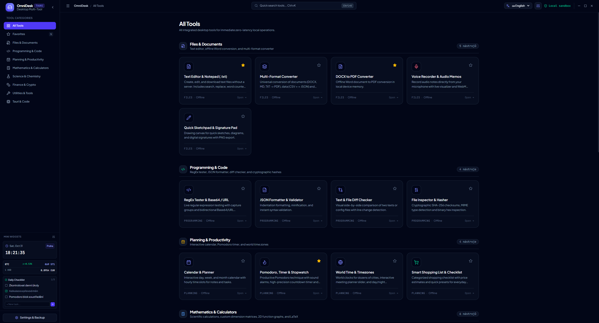
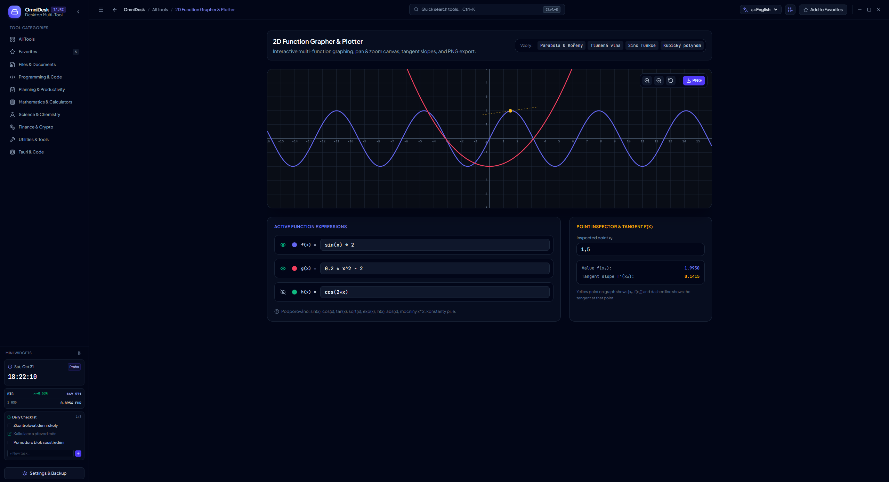
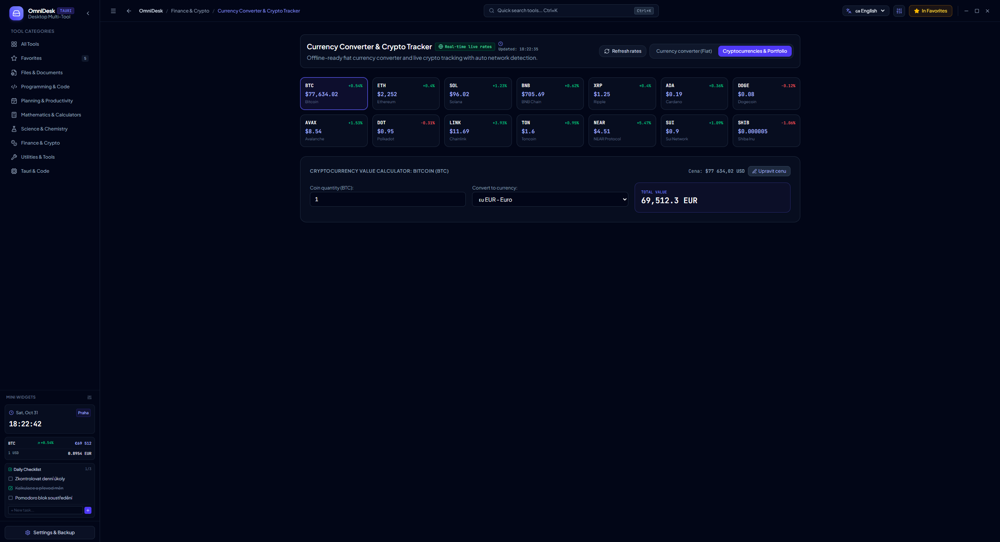
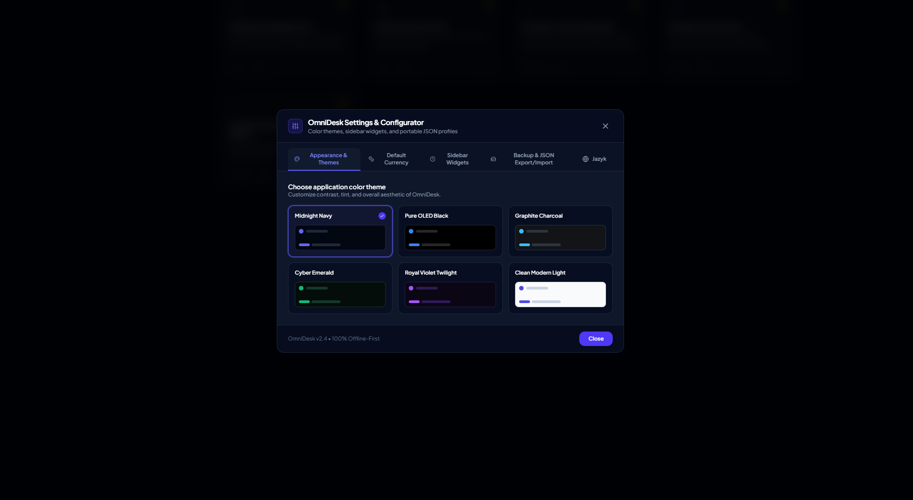

# OmniDesk — Universal Desktop Multi-Tool Platform ⚡

[](https://tauri.app/)
[](https://react.dev/)
[](https://www.typescriptlang.org/)
[](https://vitejs.dev/)
[](https://tailwindcss.com/)
[](https://marketplace.visualstudio.com/items?itemName=lokalise.i18n-ally)
[](LICENSE)

**OmniDesk** is a modern, high-performance, and versatile desktop workstation combining **31 integrated tools** into a unified, distraction-free environment. Built with **Tauri v2 (Rust backend)** and **React 19 / TypeScript / Vite / Tailwind CSS**, it operates primarily **100% offline** directly in device memory with zero server telemetry, while supporting native OS hardware monitoring, local filesystem processing, a translucent top bar matching your active color theme, and lightning-fast keyboard navigation (`Ctrl+K`).

The application defaults to **English** out-of-the-box, with dynamic, first-class localization across 5 languages (**English**, **Čeština**, **Deutsch**, **Español**, and **Русский**).

<p align="center">
  
</p>

---

## 📸 Screenshots & Visual Showcase

| 🖥️ Main Dashboard (All Tools) | 📈 2D Function Grapher & Plotter |
| :---: | :---: |
| [](docs/screenshots/dashboard.png) | [](docs/screenshots/function-grapher.png) |
| *Categorized workstation with mini-widgets & search* | *Interactive curves, tangent slopes & math formulas* |

| 💱 Live Crypto & Currency Rates | ⚙️ Application Settings & Configurator |
| :---: | :---: |
| [](docs/screenshots/crypto-rates.png) | [](docs/screenshots/settings-configurator.png) |
| *Real-time cryptocurrency ticker & value calculator* | *Themes, currency preferences, widgets & JSON backup* |

---

## 🚀 How to Run OmniDesk

You can run OmniDesk in whichever way best fits your workflow:

### 📦 1. Download Pre-Built Releases from GitHub (Easiest)
For everyday users who want to run OmniDesk without installing development tools:
1. Navigate to the **Releases** tab on the GitHub repository.
2. Download the latest compiled installer for your operating system (`.exe` or `.msi` for Windows, DMG for macOS, or AppImage/deb for Linux).
3. Run the installer and launch OmniDesk directly like any native desktop application.

---

### 💻 2. Run in Visual Studio Code / PowerShell (Tauri Dev with MSVC & Windows SDK)
If you are developing or building OmniDesk from source in VS Code or PowerShell on Windows with MSVC Build Tools and Windows SDK:

Paste and execute the following commands in your **PowerShell** terminal:

```powershell
$msvc="C:\Program Files (x86)\Microsoft Visual Studio\18\BuildTools\VC\Tools\MSVC\14.44.35207"
$sdk="C:\Program Files (x86)\Windows Kits\10"
$sdkver="10.0.26100.0"

$env:Path="$msvc\bin\HostX64\x64;$env:Path"
$env:INCLUDE="$msvc\include;$sdk\Include\$sdkver\ucrt;$sdk\Include\$sdkver\shared;$sdk\Include\$sdkver\um"
$env:LIB="$msvc\lib\x64;$sdk\Lib\$sdkver\ucrt\x64;$sdk\Lib\$sdkver\um\x64"

cd "C:\\OmniDesk-main\OmniDesk-main"
npm run tauri dev
```

*(Note: Adjust the paths for `$msvc` and `$sdk` to match the exact paths and toolset versions installed on your machine).*

In VS Code, you can also run the prepared task **Tauri Dev (MSVC)** from
**Terminal → Run Task**. It initializes the Visual Studio build environment
before starting Tauri.

---

### ⚡ 3. One-Click Startup Script (`start.bat` for Windows / `start.sh` for Mac & Linux)
1. Double-click **`start.bat`** on Windows (or run `./start.sh` on macOS/Linux).
2. The script automatically verifies Node.js, installs required packages on the first run, boots the local server, and automatically opens OmniDesk in your default browser once the server is fully ready.

---

### 🌐 4. Standard Web Development & PWA Desktop Install
```bash
# 1. Install dependencies
npm install

# 2. Start local development server
npm run dev
```
Open [http://localhost:3000](http://localhost:3000) in your web browser. From there, you can also install OmniDesk as a **PWA (Progressive Web App)** by clicking the **"Install App"** button in the header.

---

## 🌟 Architectural Highlights & Recent Updates

- 🧪 **Complete 118-Element IUPAC Periodic Table**:
  - Full authentic periodic table adhering to official IUPAC standards (periods 1–7, groups 1–18, separated lanthanide and actinide series).
  - Color-coded orbital blocks (*s, p, d, f*) and element categories (alkali metals, halogens, noble gases, etc.).
  - Interactive element modal: atomic number, relative molar mass, electronegativity, electron configurations, phase, and density.
- 💱 **Live Cryptocurrency & Exchange Rates**:
  - Real-time CoinGecko API integration for major cryptocurrencies (BTC, ETH, SOL, TON, BNB, XRP, ADA, DOGE, AVAX, etc.) with manual refresh and cached offline fallback.
  - User-configurable default fiat currency in Settings (**USD, EUR, CZK, GBP, CHF, PLN, JPY, RUB**) — automatically synced across converters and sidebar widgets.
- 📝 **Rich Text & Code Editor (.txt / .md)**:
  - Create, open, edit, and download plain text and Markdown files.
  - **Selective font sizing and case transforms applied exclusively to highlighted text**.
  - Headings (H1, H2, H3), alignment (left, center, right), regex search & replace, live word/character counters, reading time estimates, and auto-save.
- 🗂️ **Categorized Home Dashboard**:
  - All tools organized into clear, labeled categories on the home screen (Files & Documents, Mathematics, Science, Finance, Planning, Utilities).
- 🪟 **Translucent Themed Header**:
  - The top window control bar matches the active color palette with a modern semi-transparent glass aesthetic.
- 🌐 **Dynamic Internationalization (English Default)**:
  - English is the default application language, with complete localization across 5 languages: English (`en`), Czech (`cs`), German (`de`), Spanish (`es`), and Russian (`ru`).
- 🛠️ **5 Brand-New Everyday Tools Added**:
  - Discount, VAT & Tip Calculator
  - Smart Shopping List & Categorized Checklist
  - Offline Voice Recorder & Audio Memos
  - Quick Sketchpad & Signature Pad
  - Clothing & Shoe Size Converter

---

## 🛠️ Complete Integrated Tools Catalog (31 Tools)

### 📁 1. Files & Documents (`files`)
1. **Text & Markdown Editor (.txt / .md)**: File creation/editing, selective text resizing, headings, alignment, case conversion, regex search & replace, and UTF-8 download.
2. **Offline Voice Recorder & Audio Memos**: In-browser audio recording via `MediaRecorder`, live volume visualizer, playback, rename, and WebM export.
3. **Quick Sketchpad & Signature Pad**: HTML5 Canvas drawing, pen/eraser with width control, signature baseline guide, transparent/white canvas, undo, and PNG export.
4. **Multi-Format Converter**: Client-side document conversion (DOCX, MD, TXT to PDF), data conversion (CSV <-> JSON), and image transcoding (WebP, PNG, JPEG).
5. **DOCX to PDF Converter**: Local Word document rendering and vector PDF generation with zero server uploads.
6. **Text & File Diff Comparator**: Side-by-side and inline diff visualizer with line-by-line change detection.
7. **File Inspector & Hasher**: Instant SHA-256 cryptographic checksums, binary hex dump, and MIME detection.

### 📐 2. Mathematics & Calculations (`math`)
8. **Scientific Calculator**: Trigonometry (sin, cos, tan), logarithms, powers, roots, memory registers (M+/MR), and calculation history.
9. **Dynamic Matrix Calculator**: Dimensions from $1 \times 1$ to $6 \times 6$, matrix multiplication ($A \times B$, $B \times A$), determinants, inverses, transposes, and trace.
10. **2D Function Grapher & Plotter**: Interactive canvas plotting $f(x)$, $g(x)$, $h(x)$, smooth zooming, mouse drag panning, tangent inspection, and PNG export.
11. **LaTeX Formula Visualizer**: Real-time formula rendering, quick-insert symbol palette, SVG/MathML export, and equation library.
12. **Statistics & Data Analysis**: Mean, median, mode, sample variance, standard deviation, quartiles (Q1, Q3, IQR), and dynamic histograms.
13. **Combinatorics & Number Theory**: Permutations, combinations ($nCr$), variations, Euclidean algorithm (GCD / LCM), and prime factorization.

### 🔬 3. Science & Chemistry (`science`)
14. **Chemistry & Periodic Table**: Complete 118 IUPAC elements, chemical formula parser, molar mass computation, mass percentage breakdown, and solution molarity calculator ($c = n/V$).
15. **Scientific Unit Converter**: High-precision conversions for length, mass, temperature, pressure, area, volume, speed, and digital data storage.

### 💰 4. Finance & Retail (`finance`)
16. **Discount, VAT & Tip Calculator**:
    - Percentage discounts and BOGO (Buy X Get Y Free) deals with per-item savings breakdown.
    - Two-way VAT calculator (add VAT to base price or extract VAT from total) with clipboard copy.
    - Restaurant tip calculator and fair bill splitting per person with optional rounding.
17. **Currency Converter & Crypto Tracker**: 19 world currencies and 14 major cryptocurrencies with real-time live rates, offline caching, and configurable default currency.
18. **Mortgage & Loan Calculator**: Annuity payment calculation, principal-to-interest breakdown, and downloadable CSV amortization schedule.

### 📋 5. Planning & Organization (`planning`)
19. **Smart Shopping List & Checklist**: Categorized shopping items (Groceries, Drugstore, Household, Tech, Other), 1-click quick presets, total cost estimates, and clipboard export.
20. **Interactive Calendar & Event Planner**: Full month view, month/year navigation, today indicator, and local schedule planning.

### ⚙️ 6. Utilities & Everyday Tools (`utilities`)
21. **Clothing & Shoe Size Converter**: International size conversions for men's and women's footwear (EU, US, UK, CM, Inches) with foot length search, plus men's and women's apparel (XS–3XL).
22. **System Hardware Monitor**: Real-time CPU core telemetry, RAM utilization, and disk partition monitoring via native Tauri OS APIs.
23. **WCAG Contrast Validator**: Accessibility compliance checking (Level AA & AAA), color blindness simulator (Protanopia, Deuteranopia, Tritanopia, Achromatopsia), and automated contrast tuner.
24. **Color Palette Generator**: Harmonic color schemes, HEX/RGB/HSL conversion, and contrast checks.
25. **Cryptographic Password Generator**: Passwords with custom character sets and memorable Diceware passphrases with bit-entropy scoring.
26. **Offline QR Code Generator**: Vector QR codes for URLs, Wi-Fi credentials, and plain text with PNG download.
27. **RegEx Tester & Base64 / URL Encoder**: Regular expression evaluation with capture groups and bidirectional Base64/URL encoding.
28. **Pomodoro & Focus Timer**: Configurable focus/break cycles, countdown timer, and split-lap stopwatch.
29. **World Timezones & Meeting Planner**: Interactive clock with 28 world cities and meeting time scrubber slider.
30. **JSON Formatter & Validator**: Beautify, minify, and validate JSON data structures with syntax error detection.
31. **Online Translator**: Quick translation utility with automatic network status detection and offline notice.

---

## 🎨 Visual Themes (6 Built-In Palettes)

Switch themes on the fly from the **Settings & Appearance** modal:
- 🌌 **Midnight Navy** — Deep slate and navy background with vibrant indigo accents.
- 🖤 **OLED Pure Black** — True `#000000` pitch black background designed for dark rooms and maximum battery efficiency.
- 🩶 **Graphite Charcoal** — Matte technical dark grey styling tailored for developer focus.
- 🌲 **Cyber Emerald** — High-tech dark forest aesthetic inspired by classic green terminals.
- 🔮 **Royal Twilight** — Rich violet and amethyst palette.
- ☀️ **Clean Light** — Modern daylight theme with crisp white panels and clear typography.

---

## 🧩 Configurable Sidebar Mini-Widgets

In the left sidebar, users can toggle individual mini-widgets:
1. **World Clock & Date** — Live local time for your chosen world city.
2. **Quick Focus / Pomodoro Timer** — One-click 25-minute focus session with progress ring.
3. **Live Rates Ticker (Crypto & Fiat)** — Real-time price tracking for your chosen crypto and fiat currencies.
4. **Daily Tasks Checklist** — Fast interactive checklist for daily priorities.
5. **Quick Calculator & Converter** — Single-line math evaluation (`25 * 4`, `100 EUR to USD`).
6. **Quick Sticky Note (Scratchpad)** — Auto-saving notepad for temporary numbers and notes.
7. **System Gauge (CPU & RAM)** — Live hardware usage overview.

---

## 💾 Profile Backup & Device Migration (JSON)

All user preferences and data are stored locally on your device:
- **Export Backup `.json` (`omnidesk-profile.json`)**: Save full configuration with a single click.
- **Copy / Paste JSON**: Easily transfer settings across devices via clipboard.
- **Restore from File**: Load your customized workstation on any machine.
- **Factory Reset**: Revert to pristine defaults at any time.

---

## 🌍 Supported Languages (i18n)

OmniDesk features native multi-language localization with **English as the default language**:
- 🇬🇧 **English** (`en`) — Default
- 🇨🇿 **Čeština** (`cs`)
- 🇩🇪 **Deutsch** (`de`)
- 🇪🇸 **Español** (`es`)
- 🇷🇺 **Русский** (`ru`)

All dictionaries are organized under `src/locales/*.json` and are fully compatible with the **i18n Ally** extension for Visual Studio Code and Cursor.

---

## 📁 Repository Structure

```text
├── .vscode/
│   ├── settings.json       # i18n Ally & VS Code preferences
│   └── extensions.json     # Recommended extensions (i18n Ally, Tauri, Rust)
├── docs/
│   └── screenshots/        # High-resolution application screenshots for GitHub
├── public/                 # Static assets, logos, and PWA manifest
├── src/
│   ├── components/
│   │   ├── layout/         # Header, Sidebar, ToolGrid, CommandPalette, SidebarWidgets
│   │   └── ui/             # ConfigModal, PWAInstallButton
│   ├── i18n/               # Reactive translation context (English default)
│   ├── locales/            # Translation dictionaries (en, cs, de, es, ru)
│   ├── services/           # Storage, theme definitions, and tauriBridge
│   ├── tools/              # 31 Modular tool implementations
│   │   ├── files/          # Text editor, Voice recorder, Sketchpad, Docx, Diff, Inspector, Multi-Format
│   │   ├── math/           # Calculator, Matrix, Grapher, LaTeX, Stats, Combinatorics
│   │   ├── science/        # Chemistry molar mass & IUPAC table, Unit converter
│   │   ├── finance/        # Discount & VAT calc, Currency & Crypto tracker, Loan calculator
│   │   ├── planning/       # Shopping list & checklist, Calendar tool
│   │   └── utilities/      # Size converter, System monitor, WCAG, Passwords, QR, RegEx, Pomodoro, Timezones
│   ├── types/              # TypeScript definitions
│   ├── App.tsx             # Root desktop workspace layout
│   └── index.css           # Tailwind CSS styles & theme overrides
├── package.json
├── start.bat               # Windows one-click launcher
├── start.sh                # macOS/Linux one-click launcher
├── tsconfig.json
├── vite.config.ts
└── README.md
```

---

## 📄 License

This project is open-source software released under the **MIT License**.
